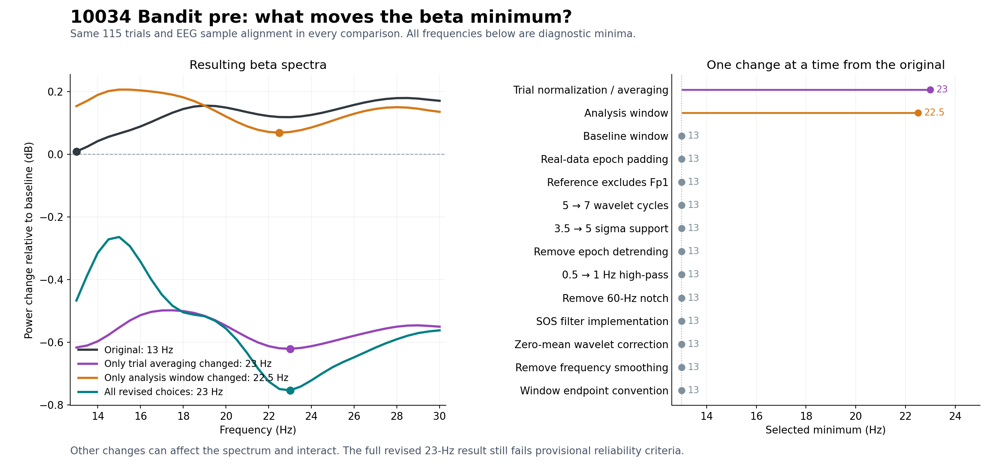

# What drives the 13-to-23-Hz change in 10034 Bandit pre?

**Follow-up:** The [normalization check](10034_normalization_check.md) finds that centering baseline and response consistently in log power retains the 23-Hz minimum but reduces its effect from −0.753 to −0.065 dB. The strong negative value below should not be interpreted as established physiological suppression.

**The analysis window and the order of trial normalization/averaging are the principal drivers in this recording.** Either change alone moves the original minimum into the 22.5–23-Hz range. The retained trials are identical. The effects interact, so the 10-Hz total shift cannot be divided into independent additive contributions.

This is a controlled comparison of `pilot_data/frequency_analysis.py` and the offline rhythm-validation pipeline for `10034_ses-1_bandit_pre_20260918104411`, completed October 23, 2026. These are diagnostic spectral minima, not established individualized frequencies.

## Direct results

Starting from the original implementation and changing only the stated choice:

- **Original:** 13 Hz, **+0.008774 dB**.
- **Change only trial normalization/averaging:** 23 Hz, **−0.620746 dB**. The original averages power across trials before baseline correction and conversion to dB. The revision baseline-corrects each trial, converts to dB, and then averages. Both implementations already compute power per channel before averaging channels; voltage cancellation is not the difference between these two beta implementations.
- **Change only the analysis window:** 22.5 Hz, **+0.068929 dB**, moving from −1.0…−0.1 s to −0.4…+0.1 s relative to the response. The positive minimum means this variant does not demonstrate suppression, despite moving into the revised frequency range.
- **All revised choices together:** 23 Hz, **−0.753483 dB**.

Changing baseline timing, real-data padding, reference, wavelet cycles/support, detrending, high-pass/notch filtering, filter implementation, wavelet zero-mean correction, smoothing, or window endpoint conventions **individually from the original** leaves its minimum at 13 Hz. This does not mean these choices are unimportant: they alter effect sizes and can interact with the two main drivers.



## Same trials, same alignment

The original functions and the revised pipeline were run separately before constructing the controlled variants. Both retain behavioral rows **1–115**, with exactly the same nearest EEG sample index for each event, and both analyze F3/FCz/F4. Rows 116–120 are excluded by both. In the revised log, row 116 lacks sufficient epoch padding and rows 117–120 fall outside the recording/alignment tolerance.

The retained set was held fixed for all hybrid variants. Each hybrid extracts its configured epoch length around the same centers. Artifact and event-selection policy therefore cannot explain the shift in this case. This is specific to this recording; it does not establish that these policies are equivalent elsewhere.

## Interactions and reverse checks

Starting from the fully revised implementation:

- Revert only trial normalization/averaging: **22.5 Hz, −0.039540 dB**.
- Revert only the analysis window: **23.5 Hz, −0.660203 dB**.
- Revert **both**: **13 Hz, −0.075084 dB**, keeping the other revised choices, including the revised baseline and padding.
- Revert only wavelet cycles from seven to five: **22 Hz**, a smaller adjustment around the revised minimum.

Thus either of the two main changes can keep the minimum away from 13 Hz in the revised context. Neither is individually necessary for the full shift. The one-change results are not additive causal shares of the 10-Hz difference.

One interaction illustrates the limitation: applying only trialwise dB averaging to the original gives 23 Hz, but applying it together with revised epoch padding while retaining the original windows and other settings gives 13 Hz. Moving the original baseline alone also does not shift the minimum. These results are why the experiment includes both forward and reverse changes, two cumulative orders, and a timing/normalization interaction grid rather than attributing the shift from a single cumulative sequence.

The normalization change itself combines two operations: normalizing power separately for each trial and averaging after the nonlinear log conversion. An additional original-code check that normalizes each trial but averages linear ratios before taking dB gives **24 Hz, +0.330898 dB**. Converting each trial's ratio to dB before averaging gives **23 Hz, −0.620746 dB**. These operations change both frequency and effect magnitude; the combined change should not be described as a cosmetic averaging adjustment.

## What the QC checks do

The revised `feature()` first finds the diagnostic minimum, then checks it. The additional localization, sign, split-half, and bootstrap rules **do not move the minimum from 13 to 23 Hz**. They decide whether it qualifies as an individualized frequency.

The reproduced full 23-Hz result still fails: no qualifying localized contrast, no absolute spectral corroboration, failed/missing split-half features, and a qualifying feature in only **3/300 bootstrap samples (1%)**. Its individualized-frequency field remains empty. The original 13-Hz result is a boundary minimum with positive power change. This comparison explains the implementation discrepancy; it validates neither frequency for stimulation and does not assess task differences or generalize to other recordings.

## Reproduce and inspect

From the repository root, using the pinned Python 3.11 validation environment, choose a new output folder for each run:

```powershell
.\.venv\Scripts\python.exe validation\experiments\compare_10034_beta.py --repo . --out validation_outputs\10034-method-comparison
.\.venv\Scripts\python.exe validation\experiments\verify_10034_beta.py . validation_outputs\10034-method-comparison
```

The first script refuses an existing output folder. The second writes an independent verification file into the completed comparison folder. Neither runs task or stimulation code or changes source data/configuration.

- [Comparison script](../validation/experiments/compare_10034_beta.py): 90 evaluated conditions covering 14 binary analysis choices, including native endpoints, forward/reverse one-change runs, two cumulative orders, and 32 timing/normalization combinations. Some conditions repeat intentionally. The artifact/event-selection policy is checked through native trial identity comparison rather than added as a fifteenth numerical factor.
- [Independent verification script](../validation/experiments/verify_10034_beta.py): repeats the two main one-change results using the original `morlet_tfr`, `baseline_correct_db`, `beta_analysis`, and `find_peak` functions, independently of the comparison script's transform implementation.
- [Full results and provenance](../validation/10034_beta_comparison/comparison.json): every condition's settings and spectrum, retained row/sample identities, original/revised endpoints, revised QC results, and input/source SHA-256 hashes.
- [Plain-text condition results](../validation/10034_beta_comparison/comparison.txt).
- [Independent verification results](../validation/10034_beta_comparison/independent_verification.json).

The historical source was verified byte-identical to `pilot_data/frequency_analysis.py` on main commit `1c2784224fee0f2573f16abfd711162941b1e9d9` (Git blob `dcda1cb857093bce6810f61d6f7e87d5be938e07`). The revised code was read from branch commit `e3b0df59c6d77f7668a02f4d6c0bbdce27c54a23`. The comparison harness reproduces the historical endpoint effect and the full revised 13–30-Hz spectrum within **1e−10 dB**; the native revised key results exactly match the previously saved pilot result. The independent original-code checks also agree within 1e−10 dB.

The hybrid comparisons convolve only the 13–30-Hz bins because each bin is calculated independently; the native revised check uses its full 8–40-Hz grid and all reliability gates. Hybrid minima do not receive a claim of passing those gates. The code/configuration used by the production analysis is unchanged.
