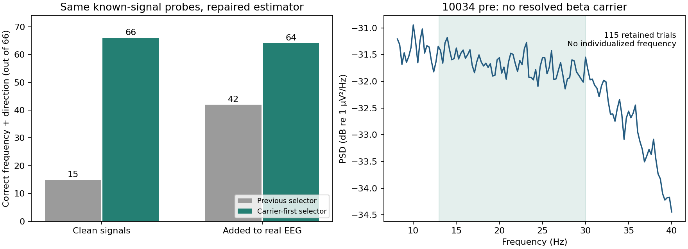

# Carrier-first estimation: completed repair and pilot rerun

**Recommendation: use v1.2 for offline frequency analysis, but do not use these pilot results to assign individualized stimulation frequencies.** The method now recovers the known carriers that exposed the earlier error. The native pilot data still provide no qualified individualized target. That does not establish that all EEG is bad.



## What changed

The mean-log-ratio normalization fix is retained. Frequency selection now uses a local peak in the absolute, full-epoch Hann power spectrum. Task-related power change is measured separately at that frequency. The largest relative change is preserved as `contrast_extremum_hz_descriptive`; it cannot become a target merely because it is the minimum or maximum in a band.

Acceptance requires a resolved, unambiguous carrier; task change with the expected direction; evidence that the change is concentrated around the oscillation rather than only broadband; adequate trials/channels; reproducible chronological and odd/even estimates; agreement between early and late portions of epochs; and block-bootstrap support. Frequencies selected in one chronological half must also show the required task modulation in the other half. No stimulation assignment, raw data, preprocessing thresholds, reference, task window, or protocol file was changed.

The carrier is an **ongoing narrow component with event-related modulation**. This is a deliberate change in the quantity being estimated. A full-epoch spectrum cannot establish a response-only oscillation, motor-cortex origin, neural rather than artifact origin, or an optimal stimulation frequency.

## Validation results

- Development: 27/27 known-frequency cases accepted; 0/27 unsuitable controls accepted after adding the within-epoch drift screen. An earlier development run accepted one theta sweep; this prompted that screen before held-out evaluation.
- New held-out validation: **54/54 known-frequency cases correctly recovered and accepted; 0/81 unsuitable controls accepted.** This includes noise, stationary oscillations without task modulation, broadband changes with/without a stationary peak, trial-wise frequency switches, band-boundary peaks, nonoscillatory transients, frequency sweeps, and competing rhythms. New seeds, off-grid frequencies, colored backgrounds, trial counts of 40/80/120, dependent trial gains, and native 500-Hz sampling distinguish this set from development. Both sets use the documented synthetic signal family; this is not independent biological validation. Zero false acceptances in 81 tests still allows an approximately 4.5% upper two-sided 95% binomial bound within this test mixture.
- Exact rerun of the previous 132 additive probes: **66/66 clean signals recovered** (previously 15/66); **64/66 real-EEG additions recovered** (previously 42/66). All clean probes and 56/66 real-background probes passed acceptance. No incorrect recovery was accepted. Eight correctly located real-background probes failed acceptance; most lacked a detectable carrier in one temporal portion, and some lacked reproducible selective modulation. Both location failures were weaker 5/6-Hz additions to 10579 post-Bandit theta.
- Full pilot rerun: **38 recordings, 95 analyses, zero accepted targets.** All 95 eligible/retained counts and all 70 event logs match v1.1. The first limiting stages are 44 unresolved input/timing analyses, 13 with no/too few eligible trials, 29 with limited channel/retained-trial yield, and nine with sufficient yield but no resolved carrier meeting the criteria. These are analysis-stage counts, not diagnoses of EEG quality.

The probes were added **after preprocessing** at 3/10-µV high amplitude and one-quarter low amplitude. They establish conditional recovery at those signal levels; they do not validate acquisition, prove absence of weaker endogenous rhythms, or validate the artifact-rejection rules. The probe assessments intentionally use retained count as eligible count to isolate the estimator; the native pilot rerun retains the original retention gate. Eleven Bandit analyses had enough retained trials for probing; this is not real-SST validation.

For **10034 Bandit pre**, 115/120 trials remain. The relative-change minimum is still 23 Hz, with −0.0651 dB after the normalization correction. There is **no resolved beta carrier**, so the frequency estimate is now blank. Neither 13 nor 23 Hz is justified as an individualized target. The separate acquisition/reference concern remains: highly similar channels and very small residual amplitude after reference warrant checking existing acquisition records; the analysis cannot identify its cause.

## Frozen rules and interpretation

`code/rhythm_validation_config.json` records all settings. Carrier selection uses an unpadded Hann periodogram of each complete retained epoch, power averaged across channels and trials, with log-parabolic interpolation around a local PSD maximum. Three-dB local prominence is required. A robust log-log background line supplies a linear excess-power width/competition diagnostic; it is not a full periodic/aperiodic model, and it does not choose the peak frequency. Maximum linear half-height widths are 2.5 Hz for beta and 1.5 Hz for theta; another peak with at least half the selected excess power is ambiguous. The boundary margin is 0.3 Hz. These settings favor narrow, separable carriers and may reject genuine broad or transient rhythms.

The separate task check requires at least 0.5 dB in the expected direction and at least 20% selective modulation. The auxiliary selective fraction subtracts interpolated absolute Morlet-power flanks at ±2f/cycles, with each trial scaled by its mean baseline grid power before averaging. It is a specificity diagnostic, not a claim to isolate aperiodic physiology. Its bootstrap lower interval must exceed 20%. Chronological/odd-even carrier disagreement is limited to 1.5 Hz beta / 0.75 Hz theta; bootstrap width is limited to 2 Hz beta / 1 Hz theta. Early/late epoch location must agree with the full-epoch carrier to the same split tolerances. Minimum 40 trials, 60% retention, two ROI channels, 300 circular block-bootstrap draws, block length five, and 80% carrier detection remain required. Bootstrap location detection is now distinct from joint carrier-plus-effect acceptance. The effect interval uses the fixed full-sample carrier; cross-fit checks separately address selection reuse, without claiming a fully calibrated inferential test.

No threshold was tuned against native pilot acceptance. The original held-out result is preserved as `initial_heldout.json`. Afterwards, reporting was corrected so a missing split estimate is not labeled numerical frequency instability, and no eligible events are categorized as trial scarcity. No numerical estimator or acceptance threshold changed. The release reruns verify identical frequencies and acceptance decisions; the initial carrier source is preserved beside the original evidence.

These results repair demonstrated software/quantification failures and test specified false positives. They do not validate every possible rhythm, weaker amplitudes, harmonics, reference artifacts, alternative windows, independence of overlapping epochs, across-day reliability, or stimulation efficacy. Theta/beta should remain task- and event-specific; cross-task equality is not an acceptance criterion. SST theta is not implemented here. No fallback is automatically assigned.

## What remains for the lab

The local estimation repair, validation, and complete available-data rerun are finished. Jacob and Avi do not need to install software, rerun scripts, choose thresholds, or reverse-engineer the normalization. Any next request should be limited to existing records we cannot infer: acquisition/reference/channel evidence for 10034; confirmed participant/session mapping for unresolved identity cases; synchronization evidence for unmatched clocks; and any existing independent unstimulated same-task repeat data. These may resolve inputs or help distinguish absent/weak rhythms from acquisition limitations. They do not justify adopting an unqualified frequency now. Keep the PR open for scientific review; merging the offline tools would not approve stimulation deployment.

## Reproduce and inspect

From the repository root, using the pinned validation environment (replace `python` with its interpreter):

```sh
python -m pytest tests -q
python validation/experiments/validate_carrier_estimator.py development --out validation_outputs/my-carrier-dev
python validation/experiments/validate_carrier_estimator.py heldout --out validation_outputs/my-carrier-heldout --lock validation_outputs/my-carrier-dev/lock.json
python validation/experiments/recheck_carrier_probes.py --out validation_outputs/my-carrier-probes --lock validation_outputs/my-carrier-dev/lock.json
python code/validate_rhythms.py --skip-legacy --output-name my-carrier-pilot
```

Each output directory must be new. No source data are modified. Current checked-in pilot outputs: `validation/pilot_results_carrier_v1_2`. Validation evidence: `validation/carrier_validation_v1_2`. `provenance.json` records the pre-commit HEAD and exact source hashes; content hashes identify the computations made before the final code commit. See `verification.json` for verification and CI evidence. Older snapshots remain available.

Start at [the codebook](../code/README.md) for script roles and output fields. [SciPy's periodogram documentation](https://docs.scipy.org/doc/scipy/reference/generated/scipy.signal.periodogram.html) documents the PSD operation. [Donoghue et al.](https://doi.org/10.1038/s41593-020-00744-x) motivates separating oscillatory peaks from spectral background; our screening approximation and thresholds are not that paper's validated fitting method. The [normalization report](meanlogratio_validation_decision.md) documents the distinct mean-log-ratio correction.
