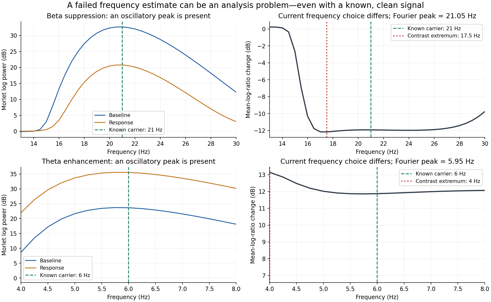

# Distinguishing EEG limitations from analysis limitations

**A failed individualized estimate is not a verdict that the EEG is bad.** We found a frequency-estimation limitation, separate acceptance-policy limitations, and separate recording/reference concerns. The earlier 0/95 passing result cannot distinguish these by itself or justify discarding the data.

The [new diagnostic summary](../validation/data_method_diagnosis/diagnostic_summary.csv) separates input/timing status, trial counts, artifact-threshold sensitivity, spatial signal measurements, and known-signal recovery. It supplements `qc_summary.csv` without changing stimulation decisions.

## Method limitation demonstrated without participant EEG

At the native 500-Hz sampling rate, a clean control containing a known **21-Hz** rhythm produced a relative-change minimum at **17.5 Hz**. An independent Fourier spectrum located **21.05 Hz**. A known **6-Hz** control produced a relative-change maximum at **4 Hz**, while Fourier located **5.95 Hz**.



The normalization correction remains valid. The additional problem is interpreting the largest relative-change frequency as the oscillator frequency. When one oscillator dominates both windows, its wavelet frequency profile approximately cancels: `P_active(f) / P_baseline(f) ≈ A_active² / A_baseline²`. The contrast can be broad or almost flat even when absolute power has a clear peak. Temporal smoothing/background power can determine the contrast extremum instead.

This is a limitation of the candidate definition **for recovering the known carrier**, not a failure to compute its defined relative-power contrast. Neither frequency is automatically the optimal tACS target.

## Known signals added to actual EEG

Eleven native analyses had at least 40 retained epochs: six response-beta and five feedback-theta analyses. Three frequencies at two amplitudes produced **66 real-background injections** and **66 matched clean controls**. Frequencies were 17/21/26 or 5/6/7 Hz; high-state sinusoidal peak amplitudes were 3 or 10 µV, with one-quarter amplitude in the low state. Recovery required the expected sign and error ≤1 Hz for beta or ≤0.5 Hz for theta.

- Current contrast-extremum recovery: **15/66 clean controls; 42/66 real-background injections**.
- Independent Fourier recovery: **132/132**. This verifies the supplied probes; a Fourier maximum alone is not a qualified native task target.
- The acceptance policy rejected **16 of the 42** accurately recovered real-background injections. Estimation and acceptance failures are distinct.
- A diagnostic absolute-peak-first alternative recovered **61/66 clean controls and 60/66 real-background injections**. It improves these checks but still fails some cases. It was developed after observing the counterexamples; this is **not held-out validation of a replacement**. The earlier 540-dataset comparison did not test it.

Probes were added to copies of retained epochs after preprocessing. They do not validate artifact screening, acquisition, native oscillation presence, or biological repeatability. Conditional probe assessments do not override original retention failures. Original EEG files were unchanged.

The earlier 72/72 recovery result used different synthetic backgrounds and sample rate. It remains valid for those models, but does not establish general estimator accuracy.

## Independent recording and trial findings

All **38 EEG recordings**, including those without matched behavior, passed checked hashes, metadata units/sample counts, regular sampling, and packet-loss-marker checks. This establishes readable data, not good electrodes or useful neural signal.

**10034 Bandit pre/post needs acquisition/reference review.** The six reference-eligible scalp channels have median pairwise correlations **0.9944/0.9956**; one spatial component accounts for **99.52%/99.61%** of filtered variance. Median frontal-channel standard deviation drops from **2.38/2.71 µV before rereferencing to about 0.16 µV afterward**. These measurements do not identify the shared signal's origin, prove a hardware fault, or establish that another reference would recover a rhythm.

**Trial scarcity is not bad EEG.** Twenty-seven analyses with available eligibility counts have fewer than 40 eligible trials before artifact rejection; timing limitations may coexist.

**Artifact screening remains provisional.** A fixed sensitivity contrast raised amplitude/step limits by 50% and the allowed bad-channel-window fraction from 20% to 30%. It can also change reference/ROI composition. Beta retention rose **1→114 for 10579 Bandit pre** and **0→102 for 10383 Bandit pre**; original exclusions were predominantly the ocular-spread rule. This demonstrates dependence on screening choices, not that the newly admitted trials are clean. The settings were not adopted or optimized using peak outcomes.

First limiting stages across the 95 analyses are **44 input/timing**, **13 no/too few eligible trials**, **29 channel/retained-yield limitations**, and **9 sufficient count/retention but no qualified native target**. These are workflow stages, not exclusive biological causes. Eleven analyses had enough retained epochs for probes; two still failed the native retention-fraction rule.

## Next step and ownership

Prioritize **method repair and validation**, rather than declaring the EEG unusable. We own that work: identify an oscillatory peak using absolute/periodic spectral structure, evaluate task modulation separately, validate both selection and acceptance on independent signal/no-target controls, and audit ocular/reference screening against actual epoch traces. The peak-first prototype is evidence for that direction, not a deployment method. Production selection/thresholds remain unchanged.

Jacob and Avi can supply acquisition/reference and channel-integrity records for 10034, unresolved identity/clock records, and any existing unstimulated repeats. No pipeline rerun, threshold choice, wholesale “bad EEG” labeling, or new participant collection is requested. [Specific requests](next_steps_for_jacob_avi.md).

Individualized stimulation remains unsupported because of demonstrated method limitations plus independent input/yield/reference concerns. This is not evidence that all subjects lack theta/beta rhythms.

## Artifacts and reproduction

- [95 diagnostic rows](../validation/data_method_diagnosis/diagnostic_summary.csv).
- [Trial-yield sensitivity and 132 probe results](../validation/data_method_diagnosis/diagnostics.json).
- [38 EEG-only spatial/channel measurements](../validation/data_method_diagnosis/spatial_quality.json).
- [Verification](../validation/data_method_diagnosis/verification.json) and [test log](../validation/data_method_diagnosis/tests.txt): **72 passed, one documented obsolete GUI test skipped**.

Use new paths from the repository root in the pinned environment:

```powershell
python validation/experiments/diagnose_data_vs_method.py --out validation_outputs/new-data-method-diagnosis
python validation/experiments/audit_eeg_spatial_quality.py --out validation_outputs/new-spatial-audit
python validation/experiments/plot_data_method_diagnostics.py --out validation_outputs/new-counterexample.png
python -m pytest tests -q
```

Retained-epoch counts are checked against the saved input-recovery snapshot. Source/configuration/manifest hashes accompany the results. Diagnostic alternatives never authorize stimulation.
